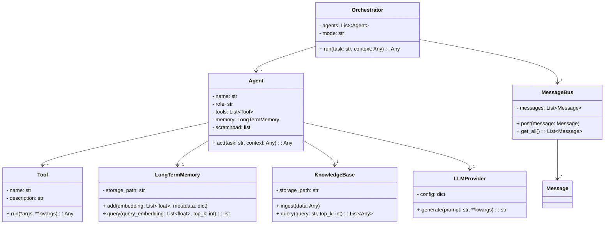
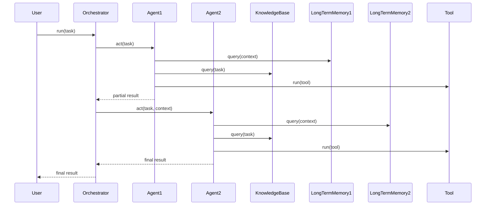

## Product Requirements Document (PRD): The "FastPath" Agentic Framework

**Version:** 1.1 (Revised for Advanced Features)
**Date:** June 24th, 2025
**Status:** Draft
**Author:** Product Management

---

### **Executive Summary of Changes (v1.0 -> v1.1)**

This revision significantly expands the scope and ambition of the FastPath framework. Based on feedback and forward-looking requirements, this version moves three key features from "Out of Scope" into the core product definition for the initial release:
1.  **Local LLM Support:** The framework will natively support popular local model servers like Ollama, llama.cpp, and vLLM, enabling privacy-focused, offline, and cost-effective deployments.
2.  **Persistent Long-Term Memory:** Agents will now have the ability to retain and recall information across separate tasks and sessions, moving beyond ephemeral "scratchpad" memory.
3.  **Real-Time Collaboration:** The framework will support a dynamic, real-time collaboration model in addition to the sequential orchestrator, allowing agents to work concurrently in a shared environment.

---

### 1. Introduction & Vision

**Product Name:** FastPath Agentic Framework

**Vision:** To empower developers and organizations to build, deploy, and manage teams of small, specialized, autonomous AI agents that can collaborate to solve complex knowledge-based tasks. FastPath will bridge the gap between disparate data sources and actionable intelligence, powered by a robust, easy-to-use framework that **runs anywhere, from cloud APIs to local machines**, and endows agents with **persistent memory** and **dynamic collaboration** capabilities.

**Elevator Pitch:** FastPath is an open-source framework for creating "agent swarms." Instead of a single AI, you create a team of specialized agents with persistent memory. They can collaborate in real-time, ingest data from anywhere (web, SharePoint, local files), build shared knowledge bases (RAG), and leverage any LLM—from GPT-4 to a local Llama 3 model on your laptop. FastPath automates complex research, analysis, and reporting with unprecedented flexibility and power.

---

### 2. The Problem

(This section remains largely the same, but the problems are now solved more comprehensively)

Knowledge workers spend an inordinate amount of time on low-value, repetitive tasks due to:
1.  **Data Silos:** Critical information is scattered across local directories, internal SharePoint sites, and the public web.
2.  **Cognitive Overhead & Lack of Specialization:** Monolithic agents struggle with complex tasks, losing context and failing to break down problems effectively.
3.  **High Barrier to Entry:** Building robust multi-agent systems with RAG, memory, and flexible LLM backends requires massive bespoke engineering effort.
4.  **Vendor Lock-in and Privacy Concerns:** Reliance on proprietary, cloud-based LLMs creates dependencies, raises costs, and is a non-starter for organizations with sensitive data.

---

### 3. Target Audience & Personas

(Personas remain the same, but their goals are now more ambitious)

1.  **The AI/ML Engineer (Developer):** Now aims to build solutions that can run entirely on-premise for security or cost reasons, and wants to create agents that learn and improve over time.
2.  **The Business Analyst / Knowledge Worker (End-User):** Expects the system to remember previous requests and context, providing a more personalized and intelligent experience.
3.  **The IT Administrator:** Now requires tools to manage local model deployments and the persistent storage associated with agent memories, in addition to cloud credentials.

---

### 4. Core Concepts & Terminology

*   **FastPath Agent:** An autonomous agent with a **Role**, **Tools**, and now, its own persistent **Long-Term Memory Store**.
*   **Tool:** A specific function an agent can execute.
*   **Knowledge Base (KB):** A *shared*, task-specific RAG data store.
*   **Long-Term Memory (LTM):** An *agent-specific*, persistent vector store for retaining key facts, conversations, and learnings across multiple tasks.
*   **Task:** A high-level objective defined by a user.
*   **The Orchestrator:** The "manager" of the framework. It now supports two modes:
    *   **Sequential Mode:** A top-down planner that assigns tasks sequentially.
    *   **Collaborative Mode:** A "moderator" that facilitates real-time, event-driven communication between agents in a shared workspace.
*   **LLM Provider:** A pluggable interface for connecting to different language models, whether via cloud API or a local server.

---

### 5. Features & Requirements

#### **M-1: The FastPath Core Framework**

*   **REQ-1.1: Agent Definition:** Users must be able to define an agent specifying its role, system prompt, tools, and configuration for its Long-Term Memory.
*   **REQ-1.2: Orchestrator Engine:** (Revised) The framework must include a flexible Orchestrator that can operate in different modes (configurable per task).
*   **REQ-1.3: Tool Abstraction:** Provide a simple interface for developers to create new, custom tools.
*   **REQ-1.4: Pluggable LLM Backend (New):**
    *   The framework must abstract the LLM interface.
    *   Users must be able to configure the LLM provider in a central configuration file.
    *   **Must provide out-of-the-box support for:**
        *   OpenAI API-compatible endpoints (including vLLM).
        *   Ollama servers.
        *   Direct loading of GGUF models via `llama-cpp-python`.

#### **M-2: Data Ingestion & RAG Tools (Knowledge Base Creation)**

*   (No changes here. Requirements REQ-2.1 through REQ-2.4 for Directory, Website, and SharePoint readers remain the same.)

#### **M-3: Advanced Agent Collaboration & Cognition** (Revised Section)

*   **REQ-3.1: Knowledge Base Query Tool:** All agents must have a tool to query the shared, task-specific KBs.
*   **REQ-3.2: Dynamic Collaboration Models:** (Revised) The framework must support two primary collaboration patterns:
    *   **Orchestrator-Led (Sequential):** The Orchestrator creates a static plan and delegates tasks sequentially, passing outputs from one agent to the next.
    *   **Conversational Swarm (Real-Time):** Agents are placed in a shared "workspace" (message bus). One agent can post a message (e.g., a question, a piece of data), and other agents can react to it concurrently, with the Orchestrator acting as a moderator to guide the conversation and determine when the task is complete.
*   **REQ-3.3: Logging & Transparency:** Must produce detailed, real-time logs of agent "thoughts," tool usage, and inter-agent communication for both collaboration models.

#### **M-4: User Experience & Interface**

*   (Requirements REQ-4.1 for CLI and REQ-4.2 for a simple Web UI remain the same.)

#### **M-5: Security & Configuration**

*   **REQ-5.1: Secure Credential Management:** Use environment variables or a secure vault system for API keys.
*   **REQ-5.2: Expanded Configuration File:** (Revised) A central `config.yaml` must manage framework settings, now including LLM provider selection.
    *   **Example `config.yaml`:**
        ```yaml
        llm_provider: ollama # 'openai', 'ollama', 'vllm', 'llama_cpp'
        
        llm_config:
          # For Ollama or vLLM
          model: 'llama3:8b'
          base_url: 'http://localhost:11434' 
          
          # For OpenAI
          # model: 'gpt-4o'
          # api_key: ${OPENAI_API_KEY}

          # For llama_cpp
          # model_path: '/path/to/your/model.gguf'
          # n_gpu_layers: -1 # -1 to offload all layers to GPU
        
        embedding_model: 'all-MiniLM-L6-v2'
        vector_store_path: './fastpath_db'
        ```

#### **M-6: Persistent Long-Term Memory (New Section)**

*   **REQ-6.1: Agent-Specific Memory Store:** Each agent instance must be associated with its own persistent vector store for long-term memory.
*   **REQ-6.2: Automated Memory Ingestion:** After a task is completed, the Orchestrator will prompt a "Reflector" agent to summarize the key takeaways, decisions, and learned facts from the task's scratchpad. This summary is then embedded and stored in the LTM of the participating agents.
*   **REQ-6.3: Proactive Memory Retrieval:** At the beginning of a new task, the agent's system prompt will be augmented with relevant information retrieved from its LTM based on the task description. This gives the agent "context" from past experiences.

---

### 6. Out of Scope for v1.1

*   GUI for building/visualizing agent workflows and memory graphs.
*   Support for non-text modalities (image, audio).
*   Complex, role-based access control (RBAC) for Knowledge Bases or Long-Term Memories.
*   Automated tool creation or self-healing code.

---

### 7. Success Metrics

*   **Developer Adoption:** Number of GitHub stars/forks, pip/conda downloads.
*   **Task Completion Rate:** >90% success rate for benchmark tasks.
*   **Time to First "Hello, Local Agent!":** A developer can run a task using an Ollama-powered agent in under 15 minutes.
*   **Demonstrable Memory:** A benchmark task where an agent is asked a follow-up question in a new session and correctly uses information from its LTM to answer.
*   **Real-Time Collaboration Success:** Successful completion of a task requiring at least 3 agents to exchange information in the conversational swarm model to find a solution.
*   **Performance:** Benchmarks for RAG creation time, and task completion time on both cloud and local LLMs (e.g., GPT-4o vs. Llama 3 8B on specific hardware).

---

### 8. Assumptions & Dependencies

*   **LLM Access:** Users have access to cloud LLM APIs **or** have the necessary hardware and software (e.g., Ollama installed) to run local models.
*   **Compute Resources:** Users have sufficient local compute (CPU/RAM/VRAM) and storage for running models, embedding, and storing vector databases for KBs and LTMs.
*   **Python Environment:** The framework will be built in Python.

---

## Implementation Details

### Class Architecture



### Sequence Diagram (Sequential Execution)



### Instructions for Running Tests

1.  Install dependencies (if you haven't already):
    ```bash
    poetry install
    ```
2.  Run tests:
    ```bash
    poetry run pytest
    ```

### Configuring a New Agent Team

1.  Define your custom tools in their own module or in `tools.py`.
2.  Implement your agents by inheriting from `Agent` and overriding the `act` method.
3.  Instantiate the agents and the orchestrator in a script, for example:
    ```python
    from fastpath.agent import Agent
    from fastpath.memory import LongTermMemory
    from fastpath.tools import Tool
    from fastpath.orchestrator import Orchestrator

    class MyTool(Tool):
        def __init__(self):
            super().__init__(name="my_tool", description="My custom tool")
        def run(self, text_to_reverse: str):
            return text_to_reverse[::-1]

    class MyAgent(Agent):
        def act(self, task: str, context=None):
            # For simplicity, this agent just uses its first tool
            tool_result = self.tools[0].run(task)
            return f"{self.name} solved the task. Result: {tool_result}"

    # 1. Create the building blocks
    tool = MyTool()
    memory = LongTermMemory(storage_path=":memory:") # Using an in-memory placeholder

    # 2. Create the agent
    my_agent = MyAgent(name="AgentX", role="Text Reverser", tools=[tool], memory=memory)

    # 3. Create the orchestrator with the agent
    orchestrator = Orchestrator(agents=[my_agent], mode="sequential")

    # 4. Run the task
    final_result = orchestrator.run("reverse this text")
    print(final_result)
    ```

### Running the System

You can run the minimal example included in `src/main.py`:

```bash
poetry run python src/main.py
```

Or run your own script following the example above.

### Advanced Configuration

The framework is configured via the `config.yaml` file, allowing you to easily switch between different LLMs and embedding models.

#### LLM Provider (`llm_provider`)

This setting determines which Language Model Provider agents will use by default. Supported options are:
*   `openai`: For using models like GPT-4, GPT-3.5, etc. Requires an `OPENAI_API_KEY`.
*   `gemini`: For using Google's Gemini models. Requires a `GEMINI_API_KEY`.
*   `ollama`: For connecting to a local Ollama server.

**Example:**
```yaml
llm_provider: openai
```

#### Embedding Provider (`embedding_provider`)

This setting determines which model is used to create embeddings for the `KnowledgeBase` (RAG). Supported options are:
*   `huggingface`: Uses a sentence-transformer model from Hugging Face. Runs locally.
*   `openai`: Uses one of OpenAI's embedding models. Requires an `OPENAI_API_KEY`.

**Example:**
```yaml
embedding_provider: huggingface
embedding_model: 'sentence-transformers/all-MiniLM-L6-v2'
```
or
```yaml
embedding_provider: openai
embedding_model: 'text-embedding-3-small'
```
The full example `config.yaml` shows how to structure the file with the necessary API keys and model names for each provider. Remember to set the API keys as environment variables.

## Persistent Memory Providers

FastPath supports multiple backends for agent long-term memory. You can select the provider and configure its parameters in `config.yaml`.

### Supported Providers

- **in_memory**: Stores embeddings in a Python list (default, for development/testing)
- **influxdb**: Stores embeddings in an InfluxDB bucket
- **redis**: Stores embeddings as serialized JSON in a Redis list
- **couchbase**: Stores embeddings as documents in a Couchbase bucket

### Example Configuration (`config.yaml`)

```yaml
memory_provider: redis  # Options: in_memory, influxdb, redis, couchbase

memory_config:
  in_memory: {}
  influxdb:
    url: "http://localhost:8086"
    token: "my-token"
    org: "my-org"
    bucket: "fastpath"
  redis:
    host: "localhost"
    port: 6379
    db: 0
  couchbase:
    connection_string: "couchbase://localhost"
    username: "Administrator"
    password: "password"
    bucket: "fastpath"
```

### Usage in Code

```python
from fastpath.memory import get_memory_from_config

memory = get_memory_from_config("config.yaml")
# Use memory.add(embedding, metadata) and memory.query(query_embedding, top_k)
```

### Optional Dependencies

Install only the dependencies for the backends you need:

- InfluxDB: `poetry add influxdb-client`
- Redis: `poetry add redis`
- Couchbase: `poetry add couchbase`

If a backend is selected but the dependency is not installed, an `ImportError` will be raised at runtime.

## Knowledge Base: External Vector Store Support

FastPath can use both in-memory and external vector stores for the Knowledge Base (RAG). You can select the provider and configure its parameters in `config.yaml`.

### Supported Vector Stores

- **in_memory**: Default, uses LlamaIndex's in-memory VectorStoreIndex
- **chroma**: Uses ChromaDB for persistent vector storage
- **milvus**: Uses Milvus for scalable vector search
- **elasticsearch**: Uses Elasticsearch as a vector store
- **pgvector**: Uses Postgres with the pgvector extension

### Example Configuration (`config.yaml`)

```yaml
vector_store_provider: chroma  # Options: in_memory, chroma, milvus, elasticsearch, pgvector

vector_store_config:
  in_memory: {}
  chroma:
    persist_directory: "./chroma_db"
  milvus:
    host: "localhost"
    port: 19530
    collection_name: "fastpath"
  elasticsearch:
    host: "localhost"
    port: 9200
    index_name: "fastpath"
  pgvector:
    host: "localhost"
    port: 5432
    user: "postgres"
    password: "password"
    database: "fastpath"
    table_name: "vectors"
```

### Usage in Code

```python
from fastpath.knowledge_base import KnowledgeBase

kb = KnowledgeBase(config_path="config.yaml")
kb.ingest("./docs")  # Ingests documents from a directory
results = kb.query("What is FastPath?")
```

### Optional Dependencies

Install only the dependencies for the backends you need:

- Chroma: `poetry add llama-index-vector-stores-chroma chromadb`
- Milvus: `poetry add llama-index-vector-stores-milvus pymilvus`
- Elasticsearch: `poetry add llama-index-vector-stores-elasticsearch elasticsearch`
- PGVector: `poetry add llama-index-vector-stores-pgvector psycopg2-binary`

If a backend is selected but the dependency is not installed, an `ImportError` will be raised at runtime.

---

### Example: Collaborative Orchestrator Usage

The orchestrator now supports both sequential and collaborative (real-time) modes. In collaborative mode, agents interact via a shared message bus, and the orchestrator moderates the conversation.

```python
from fastpath.agent import Agent
from fastpath.memory import LongTermMemory
from fastpath.tools import Tool
from fastpath.orchestrator import Orchestrator

class MyTool(Tool):
    def __init__(self):
        super().__init__(name="my_tool", description="My custom tool")
    def run(self, text):
        return text[::-1]

class CollabAgent(Agent):
    def act(self, task, context=None):
        messages = context if context is not None else []
        return f"{self.name} vio {len(messages)} mensajes y tarea '{task}'"

tool = MyTool()
memory = LongTermMemory(config={})
agent1 = CollabAgent(name="A1", role="R1", tools=[tool], memory=memory, llm_provider=None)
agent2 = CollabAgent(name="A2", role="R2", tools=[tool], memory=memory, llm_provider=None)

orchestrator = Orchestrator(agents=[agent1, agent2], mode="collaborative")
result = orchestrator.run("tarea colaborativa")
print(result)  # Output: A2 vio 2 mensajes y tarea 'tarea colaborativa'
```

- In collaborative mode, each agent receives the full message history and can post new messages.
- The orchestrator returns the last message posted as the result.

---

## Web Search Tool Integration (v1.1+)

FastPath ahora permite a los agentes usar herramientas web reales para obtener información actualizada desde internet. Por defecto, se integra la herramienta Google Search vía Serper (GoogleSerperAPIWrapper de LangChain), que permite búsquedas web generales y es fácilmente extensible a otras fuentes.

### Ejemplo de uso en `src/main.py`

```python
from fastpath.agent import Agent
from fastpath.memory import LongTermMemory
from fastpath.tools import LangChainToolAdapter
from fastpath.orchestrator import Orchestrator
from dotenv import load_dotenv

def main():
    load_dotenv()
    from langchain_community.utilities import GoogleSerperAPIWrapper
    web_tool = LangChainToolAdapter(
        GoogleSerperAPIWrapper(),
        name="GoogleSerperSearch",
        description="Búsqueda web en Google vía Serper (requiere SERPER_API_KEY)"
    )
    class DummyMemory(LongTermMemory):
        def add(self, embedding, metadata):
            pass
        def query(self, query_embedding, top_k=5):
            return []
    memory = DummyMemory(config={})
    from fastpath.llm_provider import get_llm_provider_from_config
    llm_provider = get_llm_provider_from_config()
    agent = Agent(name="Agente1", role="Investigador", tools=[web_tool], memory=memory, llm_provider=llm_provider)
    orchestrator = Orchestrator(agents=[agent], mode="sequential")
    result = orchestrator.run("Investiga el tema X usando fuentes web")
    print("Resultado final:", result)

if __name__ == "__main__":
    main()
```

### Requisitos
- Instala las dependencias necesarias:
  ```bash
  poetry add langchain_community
  ```
- Añade tu clave de API de Serper en el archivo `.env`:
  ```env
  SERPER_API_KEY=tu_clave_de_serper
  ```
- La herramienta web puede ser reemplazada fácilmente por otras de LangChain (Wikipedia, Bing, etc.) usando el adaptador `LangChainToolAdapter`.

---

## Orquestador en modo 'smart' y fallback inteligente

FastPath incluye un modo avanzado de orquestación llamado `smart`, que permite:
- Descomponer automáticamente un objetivo complejo en subtareas usando el LLM del orquestador.
- Asignar cada subtarea al agente más adecuado según su rol.
- Ejecutar cada subtarea y resumir el resultado global.
- Si ninguna subtarea puede ser resuelta por los agentes disponibles (por ejemplo, falta un agente con acceso web), el orquestador añade un mensaje explicativo como fallback.

### Ejemplo de uso

```python
from fastpath.agent import Agent
from fastpath.memory import LongTermMemory
from fastpath.tools import Tool
from fastpath.orchestrator import Orchestrator
from fastpath.llm_provider import get_llm_provider_from_config

# Definir agentes con distintos roles
class DummyMemory(LongTermMemory):
    def add(self, embedding, metadata):
        pass
    def query(self, query_embedding, top_k=5):
        return []

class DummyTool(Tool):
    def __init__(self):
        super().__init__(name="echo", description="Devuelve el input")
    def run(self, text):
        return text

llm_provider = get_llm_provider_from_config()

agent1 = Agent(name="Redactor", role="Escribir informes", tools=[DummyTool()], memory=DummyMemory(config={}), llm_provider=llm_provider)
agent2 = Agent(name="Analista", role="Analizar datos", tools=[], memory=DummyMemory(config={}), llm_provider=llm_provider)

# Orquestador en modo smart
orchestrator = Orchestrator(agents=[agent1, agent2], mode="smart")

# Ejemplo: objetivo que requiere investigar en internet (pero ningún agente tiene esa capacidad)
result = orchestrator.run("Investiga en internet las tendencias de IA en 2025 y redacta un informe")
print(result)
```

**Salida esperada:**
- El orquestador descompone el objetivo en subtareas.
- Si alguna subtarea no puede ser asignada a un agente compatible, se añade un mensaje fallback indicando la limitación.
- El resumen final lo genera el LLM del orquestador.

---

## Logging y trazabilidad en FastPath

FastPath utiliza el sistema estándar de logging de Python para registrar todas las acciones relevantes de los agentes y el orquestador, incluyendo:
- Timestamp de cada acción
- Nivel de log (INFO, WARNING, etc.)
- Nombre de la clase que ejecuta la acción

Esto permite depuración avanzada y auditoría de flujos complejos.

### Ejemplo de salida de logging

```
2025-06-25 18:00:00 [INFO] fastpath.Orchestrator: [Orchestrator] Ejecutando run con modo 'smart' para tarea: 'Investiga en detalle el tema ...'
2025-06-25 18:00:00 [INFO] fastpath.Orchestrator: [Orchestrator] Planificación LLM: ...
2025-06-25 18:00:01 [INFO] fastpath.Orchestrator: [Orchestrator] Ejecutando subtarea 'Buscar información web' con agente: Investigador
2025-06-25 18:00:01 [INFO] fastpath.Agent: [Agent] Ejecutando tarea: 'Buscar información web'
2025-06-25 18:00:01 [INFO] fastpath.Agent: [Agent] Seleccionando herramienta para tarea: 'Buscar información web'
2025-06-25 18:00:01 [INFO] fastpath.Agent: [Agent] LLM sugiere herramienta: 'web_tool'
2025-06-25 18:00:01 [INFO] fastpath.Agent: [Agent] Usando herramienta: web_tool
...
2025-06-25 18:00:02 [INFO] fastpath.Orchestrator: [Orchestrator] Resumen final generado por LLM.
```

Puedes ver los logs en la consola al ejecutar cualquier flujo de FastPath. Esto facilita la trazabilidad y el análisis de decisiones automáticas.

---